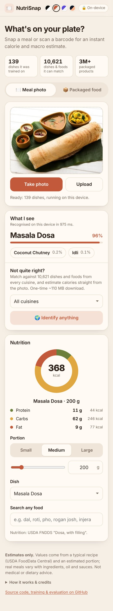
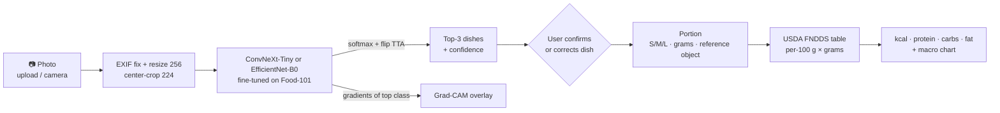
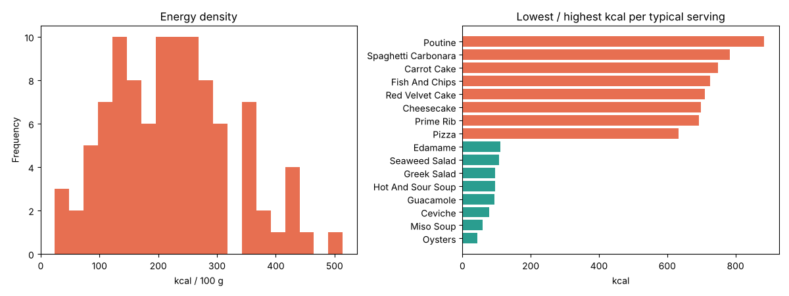
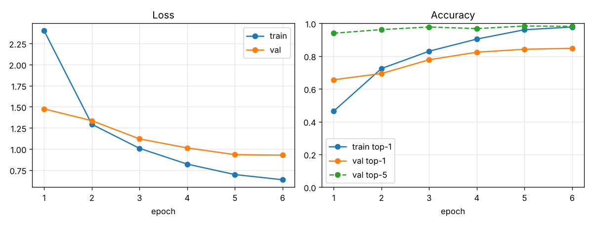
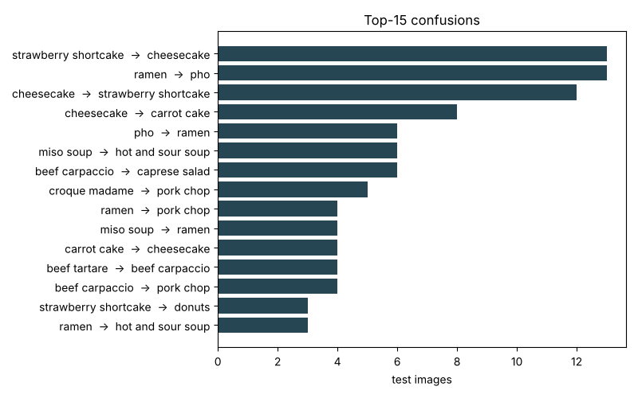
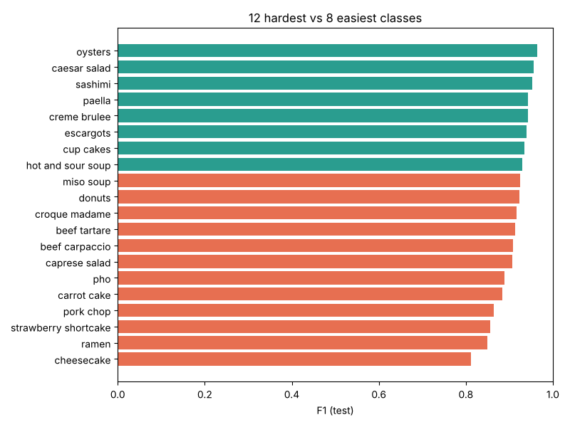
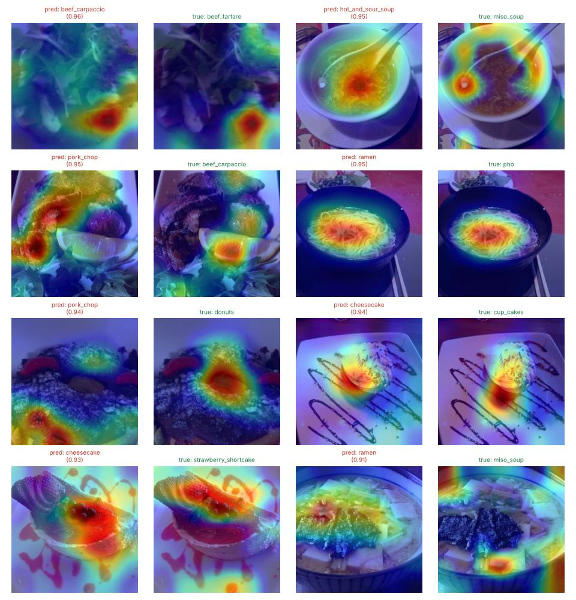
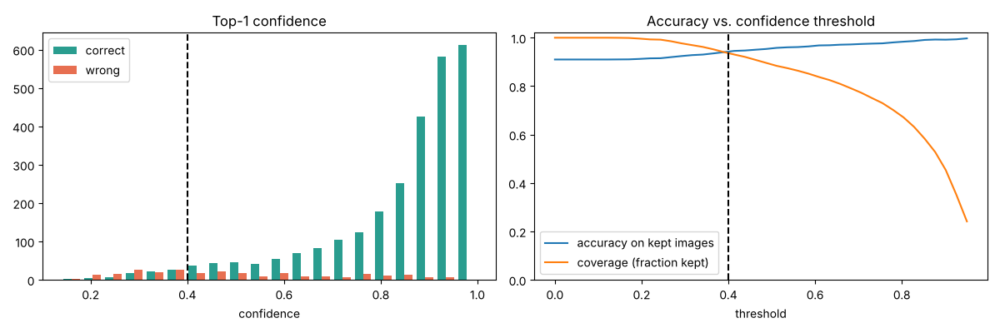

# 🍽️ NutriSnap: food photo → dish → portion → calories & macros

[](https://harshskapadia.github.io/Calories-/) [](https://colab.research.google.com/github/harshskapadia/Calories-/blob/main/notebooks/nutrisnap_colab.ipynb) [](tests/)   

Snap or upload a photo of a meal. NutriSnap recognises the dish (**139 Western and Indian dishes**), shows
**where the model looked** (Grad-CAM), estimates the **portion**, and returns **calories, protein, carbs and fat**,
with every number editable, because the model will sometimes be wrong. Anything it can't recognise can be looked
up in a **search over 5,500+ foods** (every USDA FNDDS food plus all 139 dishes).

**▶ Try it: [https://harshskapadia.github.io/Calories-/](https://harshskapadia.github.io/Calories-/)** (runs entirely in your browser; photos never leave your device)

<p align="center"></p>

> ⚠️ **All nutrition values are estimates** (typical USDA recipe × estimated portion). Not medical or dietary advice.

---

## Contents
[Problem](#problem) · [Architecture](#architecture) · [Data](#data) · [Multi-cuisine & robustness](#multi-cuisine-model-and-robustness) · [In-browser version](#in-browser-version-free-on-device) · [Results](#results) · [Error analysis](#error-analysis) · [Portion estimation](#portion-estimation) · [Run on your GPU](#run-on-your-own-gpu-recommended) · [Deploy to Hugging Face Spaces](#deploy-to-hugging-face-spaces) · [Limitations](#limitations) · [Future work](#future-work)

## Problem
Logging food is the step most people give up on in calorie tracking: searching a database and
guessing grams for every meal is tedious. NutriSnap turns it into one photo plus, at most, a correction:

1. **Classify** the dish from a photo (fine-tuned CNN on Food-101).
2. **Explain** the prediction (Grad-CAM) so users can tell when the model is looking at the wrong thing.
3. **Estimate the portion**: S/M/L presets based on USDA typical servings, a grams slider, or (experimental) a reference object in the photo.
4. **Look up nutrition** from a documented USDA FoodData Central table and scale by grams.

The design assumes the model *will* be wrong sometimes. It shows the top-3 predictions with confidence,
flags low-confidence predictions, and lets the user re-pick the dish, which re-computes the portion,
nutrition and Grad-CAM for the corrected class.

## Architecture



| Path | What it does |
|---|---|
| `data/prepare_food101.py` | Streams `ethz/food101` from the HF Hub once, pre-resizes to 256 px, writes stratified train/val/test manifests (optionally subsets) |
| `data/build_nutrition.py` | Builds `data/nutrition.csv` from USDA FNDDS via a hand-curated class mapping ([sources & method](data/NUTRITION_SOURCES.md)) |
| `src/train.py` | Config-driven fine-tuning: AdamW, warmup + cosine, label smoothing, mixed precision (fp16 CUDA / bf16 CPU), early stopping, checkpoints, CSV + plots, optional W&B |
| `src/evaluate.py` | Top-1, top-5, macro-F1, per-class report, confusion matrix, most-confused pairs, CPU latency |
| `src/ablation.py` | Trains/evaluates several backbones on identical data → results table |
| `src/predict.py` | Single-image inference pipeline (top-k, TTA, Grad-CAM, nutrition) + CLI |
| `src/gradcam.py` | Backbone-agnostic Grad-CAM for any timm model |
| `src/nutrition.py` | Class → nutrition lookup, S/M/L presets, gram scaling |
| `src/portion.py` | Reference-object (card/coin) area-based portion estimate |
| `app/app.py` | Mobile-first Gradio app |
| `run_all.py` | One command for the whole pipeline (data → baseline → ablation → final model → evaluation → analysis → app model) |
| `notebooks/` | EDA, error analysis, Colab notebook for full-data GPU training |
| `configs/` | YAML experiment configs |
| `tests/` | Unit tests for nutrition, prediction pipeline and portion estimation |

## Data

**Images.** Datasets are registered in [`data/sources.yaml`](data/sources.yaml) and merged into one label space
(shared dishes such as pizza, samosa or Indian "burger" = Food-101 "hamburger" become one class):

| Dataset | Dishes | Images | Licence |
|---|---|---|---|
| [Food-101](https://data.vision.ee.ethz.ch/cvl/datasets_extra/food-101/) (Bossard et al., ECCV 2014), `ethz/food101` | 101, mostly Western | 101,000 | research use |
| [Enhanced Indian Food Classification](https://huggingface.co/datasets/SohlHealth/enhanced-indian-food-classification) (SohlHealth) | 43 Indian (biryani, dosa, idli, chapati, dal makhani, chole, paneer dishes, poha, momos, gulab jamun, chai…) | 15,404 | CC-BY-4.0 |
| **Merged** (`configs/gpu/multi_convnext_tiny.yaml`) | **139** (5 shared) | 116,404 | |

Food-101's training images were intentionally left uncleaned and contain label noise. The Indian dataset is
web-scraped: some images carry watermarks, and its own test split is missing ~20 dishes, so for any class with
fewer than 20 test images a test set is held out of its training pool, so every class is evaluated (verified: no image
appears in two splits). Vietnamese and other datasets found on the Hub were left out because they state no licence.

| Split | Source | Used for |
|---|---|---|
| train | official train minus 10% (stratified, seed 42) | fitting |
| val | 10% held out of official train | early stopping / model selection |
| test | official test (250/class) | final numbers only |

Augmentations (train): RandomResizedCrop(224, scale 0.35–1), horizontal flip, RandAugment(2, 9),
ColorJitter(0.2), RandomErasing(0.1). Eval: resize 256 → center crop 224. No raw data is committed.

**Nutrition: USDA FoodData Central, FNDDS 2021–2023** (public domain). Every dish is mapped by hand to FNDDS
foods: 74 exact matches (FNDDS includes roti, idli, dosa, pakora, palak paneer, fish curry…), 20 close,
40 composite recipes (e.g. dal makhani = lentils + kidney beans + butter + cream) and 5 documented proxies.
Typical serving weights come from FNDDS portion data, or Indian-typical portions (1 katori, 2 chapatis) for new dishes.
All 5,431 FNDDS foods are also exported to `data/food_search.csv` for the app's search box. See
[data/NUTRITION_SOURCES.md](data/NUTRITION_SOURCES.md).

<p align="center"></p>

## Multi-cuisine model and robustness

| Problem | What NutriSnap does |
|---|---|
| Food-101 is mostly Western | Adds 43 Indian dishes (139 total); new datasets plug in via `data/sources.yaml` |
| No model knows every dish | **Search any food**: 5,570 entries (all dishes + every USDA FNDDS food), and a clear *"not sure: pick or search"* message below 40% confidence |
| Real phone photos are blurry, compressed and tilted | `phone_aug`: random perspective, Gaussian blur, JPEG re-compression (q 30–90), occasional greyscale, on top of RandAugment / ColorJitter / RandomErasing |
| Some dishes have 100 photos, others 1,000 | `balanced_sampling`: sample weight ∝ 1/√(class count) |
| Raw softmax confidence is over-confident | **Temperature scaling** fitted on the validation set after every training run (and `python -m src.calibrate` for existing checkpoints); the app shows calibrated confidence and the evaluation reports ECE |

### Multi-cuisine results (139 dishes, 26,836 test images)

Trained with `python run_all.py --final-config configs/gpu/multi_convnext_tiny.yaml --steps data final evaluate analysis export summary --batch-size 16 --workers 2`
on a laptop **RTX 3050 Ti (4 GB)**: ConvNeXt-Tiny, 10 epochs × ~10.5 min, phone-photo augmentation, balanced sampling.

| Model | Dishes | Test top-1 | Test top-5 | Macro-F1 |
|---|---|---|---|---|
| ConvNeXt-Tiny, Food-101 only | 101 | 89.2% | 98.1% | 0.892 |
| **ConvNeXt-Tiny, Food-101 + Indian** (app model) | **139** | **88.8%** | **97.7%** | **0.893** |

Adding 38 Indian dishes (and the harder phone-photo augmentation) kept accuracy level while extending coverage by 38%.
The two test sets differ (the 139-dish one adds Indian test images), so this is a like-for-like *coverage* comparison,
not an identical-benchmark one. Per-class scores, the confusion matrix and calibration (ECE before/after temperature
scaling) are in [`results/multi_convnext_tiny/`](results/multi_convnext_tiny/).

A CPU smoke test of the same pipeline (12 random dishes from both datasets) showed temperature scaling cutting
expected calibration error from 0.21 to 0.09 on validation.

## In-browser version (free, on-device)

The live demo is a static site in [`docs/`](docs/) (GitHub Pages) that runs the 139-dish model **inside the visitor's browser**
with [ONNX Runtime Web](https://onnxruntime.ai/): no server, no GPU, no cost, and photos are never uploaded.

| Model file | Size | Test top-1 (2,000-image sample) | Top-5 | CPU time / image |
|---|---|---|---|---|
| PyTorch → ONNX fp32 | 112 MB | 88.8% | 97.9% | 43 ms |
| **ONNX, int8 weights (dynamic quantization of MatMul/Gemm)** | **34 MB** | **89.0%** | **97.8%** | **25 ms** |

The quantized model agrees with fp32 on 99% of images, so quantization is free here. In the browser (single-threaded
WebAssembly, flip test-time augmentation, calibrated softmax) the page reproduced the Python predictions on all 9
example photos (confidence within 0.5 points) at ~1 s per photo. The page has camera input, top-3, the
"not sure" warning, dish correction, portion presets/grams, macro breakdown and the 5,570-food search. Grad-CAM stays in the
Gradio app (`python app/app.py`).

### Packaged foods and drinks (barcode + product search)

For anything in a package (biscuits, chips, shakes, lassi, protein drinks…) the page looks the product up in
[Open Food Facts](https://world.openfoodfacts.org), the open database of ~3 million products (data under the ODbL,
credited on the page):

- **📷 Live barcode scanning** with the phone camera: the browser's built-in `BarcodeDetector` where available
  (Chrome on Android), otherwise [zxing-wasm](https://github.com/Sec-ant/zxing-wasm) (vendored, loaded only when needed).
  Also works from a **barcode photo** or by **typing the number**.
- **Search by name** ("Amul lassi", "protein shake").
- A **full nutrition label** per portion and per 100 g / 100 ml: energy, fat, saturates, carbs, sugars, fibre, protein, salt,
  plus **Nutri-Score**, **NOVA** processing group, ingredients and allergens; drinks automatically switch to ml.

Tested end to end in Chromium with real products: typed barcode (Britannia 5050, Nutri-Score E), a barcode photo and a
**live camera stream** (fake video device showing an EAN-13; decoded and looked up in 1.8 s), and name search. Open Food Facts
rate-limits search (~10/min) and occasionally answers 503, so requests retry with backoff and then show a clear "busy" message.

Rebuild after retraining with `python scripts/build_web.py` (or `make web`); preview with `python -m http.server -d docs 8000`.

## Results

All numbers are on **held-out test images** (official Food-101 test split, never used for training or model selection).

### Development runs (CPU only, 4 cores; small subsets for fast iteration)

| Run | Classes | Train imgs | Backbone | Test top-1 | Test top-5 | Macro-F1 | CPU latency |
|---|---|---|---|---|---|---|---|
| Baseline (`configs/baseline_subset.yaml`) | 10 | 2,000 | EfficientNet-B0 | **89.6%** | 99.6% | 0.895 | 23 ms |
| + RandAugment, ColorJitter, RandomErasing, more data (`configs/ablation_effnet_b0.yaml`) | 20 | 5,000 | EfficientNet-B0 | **91.0%** | 98.8% | 0.910 | 25 ms |

<p align="center"></p>

### Full Food-101: backbone ablation (101 classes, 68k train / 25,250 test images)

Trained with `python run_all.py` on a laptop **RTX 3050 Ti (4 GB)**: batch size 16, AMP, 6 epochs, RandAugment +
ColorJitter + RandomErasing. Same data, schedule and augmentation for both; only the backbone (and its standard
learning rate) changes.

| Backbone | Test top-1 | Test top-5 | Macro-F1 | Params | CPU latency (bs 1) | GPU train time / epoch |
|---|---|---|---|---|---|---|
| EfficientNet-B0 | 83.5% | 96.4% | 0.833 | 4.1 M | 23 ms | 4.9 min |
| **ConvNeXt-Tiny** | **89.2%** | **98.1%** | **0.892** | 27.9 M | 55 ms* | 8.5 min |

**Takeaways**
- ConvNeXt-Tiny is **+5.7 points top-1** (about 35% fewer errors) for 7× the parameters and 2.4× the CPU latency.
  At 55 ms/image it is still interactive on a free CPU Space, so it is the better app model.
- EfficientNet-B0 remains the choice for on-device or very low-latency use (4 M params, ~8 MB in fp16).
- The most-confused pairs on the full set are sensible look-alikes: steak ↔ filet mignon, chocolate mousse ↔ chocolate cake,
  pork chop ↔ filet mignon, ice cream ↔ frozen yogurt.

\* Laptop CPU timings vary a lot with power mode and background load: the same architecture measured 55 ms in the ablation run and 243 ms in the multi-cuisine run.

Raw outputs: [`results/ablation_gpu.md`](results/ablation_gpu.md), per-model folders in [`results/`](results/).

## Error analysis

Full analysis: [`notebooks/02_error_analysis.ipynb`](notebooks/02_error_analysis.ipynb) (EfficientNet-B0, 20-class run, 3,000 test images).

<p align="center"> </p>

**Why it fails**
1. **Fine-grained siblings**: ramen ↔ pho, miso ↔ hot-and-sour soup, cheesecake ↔ strawberry shortcake ↔ carrot cake, beef carpaccio ↔ tartare ↔ caprese. The distinguishing cues (broth clarity, a strawberry layer, the cut of meat) are a few pixels at 224 px.
2. **Label noise and ambiguous photos**: some test "pho" bowls are indistinguishable from ramen, and a "cup_cakes" image is a plated cake slice. Food-101 deliberately contains noise.
3. **Context shortcuts**: in several confident mistakes Grad-CAM sits on a garnish, lemon wedge or plate decoration instead of the food.
4. **Lighting**: dark or coloured restaurant light removes the colour cues that separate raw beef from cooked pork.

<p align="center"></p>

**What it means for the product**

| Finding | Number | Design consequence |
|---|---|---|
| Top-3 accuracy | 97.7% | show the top-3 list, one tap to correct |
| Errors with the true dish in the top-3 | 74% | most mistakes are fixable without typing |
| Accuracy when confidence < 0.4 (6% of images) | 43% vs 94% | the low-confidence warning targets the right images |
| Misclassifications within 20% of the true kcal | only 27% (median error ~120 kcal) | errors are expensive in calories, so the correction UI matters more than another +1% accuracy |

<p align="center"></p>

## Portion estimation

Three levels, from most to least reliable:

1. **Presets**: *small / medium / large* = 0.6× / 1× / 1.5× the USDA typical serving for the selected dish.
2. **Grams slider**: the user sets an exact weight (e.g. from a kitchen scale).
3. **Reference object (experimental)**: put a credit card (85.6 × 54 mm) or a US quarter (24.26 mm) next to the plate
   and shoot from above. OpenCV finds the reference (a 4-sided contour with the card's aspect ratio, or a Hough
   circle) → pixels per cm → GrabCut segments the food → area in cm² → grams via a per-dish "grams per cm²"
   factor (≈ thickness × density: deep soups 4.0, cakes 3.0, flat foods 0.9, salads 0.6, default 1.5).
   This step is tested on synthetic scenes; on real photos it's a rough estimate (no depth information).

## Run on your own GPU (recommended)

Tested path: an NVIDIA GPU with ≥ 6 GB VRAM (e.g. a gaming laptop), Windows or Linux, Python 3.11, ~15 GB free disk.

**1. Get the code and create an environment**

```bash
git clone https://github.com/harshskapadia/Calories-.git nutrisnap
cd nutrisnap
# Windows (PowerShell):            # Linux / macOS:
py -3.11 -m venv .venv             # python3.11 -m venv .venv
.venv\Scripts\activate             # source .venv/bin/activate
```

**2. Install PyTorch with CUDA first, then the rest**

```bash
pip install torch torchvision --index-url https://download.pytorch.org/whl/cu124
pip install -r requirements.txt nbconvert ipykernel
python -c "import torch; print(torch.cuda.is_available(), torch.cuda.get_device_name(0))"   # must print True + your GPU
```
(If it prints `False`, update the NVIDIA driver; pick the CUDA wheel matching your driver at https://pytorch.org/get-started/locally/.)

**3. Run everything with one command**

```bash
python run_all.py --quick     # optional smoke test: 1-epoch runs on small subsets (still downloads the dataset once)
python run_all.py             # the real thing
```

| Step | What happens | Rough time on a laptop RTX 3060/4060 |
|---|---|---|
| `check`, `test` | GPU check, 29 unit tests | 1 min |
| `data` | downloads Food-101 from Hugging Face (~5 GB), pre-resizes to 256 px, builds splits | 15–25 min (network-bound) |
| `baseline` | 10-class baseline | 2–3 min |
| `ablation` | EfficientNet-B0 vs ConvNeXt-Tiny on **all 101 classes, full data** → `results/ablation_gpu.md` | ~1.5–3 h |
| `final` / `evaluate` | final model (ConvNeXt-Tiny by default; reused from the ablation) on the 25,250-image test split | minutes |
| `analysis` | executes the error-analysis notebook for the final model | 2 min |
| `export` | fp16 app model → `app/model/nutrisnap.pt` | seconds |
| `summary` | `results/SUMMARY.md` | seconds |

Useful flags: `--steps data ablation` (run selected steps; finished steps are skipped on re-runs),
`--final-config configs/gpu/ablation_effnet_b0.yaml` (ship the smaller, faster EfficientNet-B0 instead of the default ConvNeXt-Tiny), `--batch-size 16`
(if you see *CUDA out of memory*), `--workers 2` (fewer DataLoader processes; use it if Windows shows error 1455 "paging file is too small").

**4. Use the app and publish your results**

```bash
python app/app.py                    # open http://localhost:7860 (not the printed 0.0.0.0 address); GRADIO_SHARE=1 gives a phone link
python -m src.predict meal.jpg --portion large --cam-out cam.jpg     # CLI
git add results app/model notebooks && git commit -m "Full Food-101 results" && git push
```

<details><summary>Individual commands (Makefile, Linux/macOS)</summary>

```bash
make setup && make test
make data CONFIG=configs/gpu/ablation_effnet_b0.yaml
make train CONFIG=configs/gpu/ablation_effnet_b0.yaml
make evaluate CKPT=checkpoints/gpu_ablation_effnet_b0/best.pt
make export-model CKPT=checkpoints/gpu_ablation_effnet_b0/best.pt
make run-app
# any config value can be overridden:
python -m src.train --config configs/full_gpu.yaml --set train.epochs=20 train.batch_size=48
```
</details>

**No GPU?** Open [`notebooks/nutrisnap_colab.ipynb`](https://colab.research.google.com/github/harshskapadia/Calories-/blob/main/notebooks/nutrisnap_colab.ipynb) in Colab (free T4): it trains on full Food-101, evaluates, and launches the app with a public link.

## Deploy

**In-browser site (free, recommended).** The site in `docs/` is served by **GitHub Pages**: repo *Settings → Pages →
Build and deployment → Source: Deploy from a branch → Branch: `main`, folder: `/docs` → Save*. It appears at
https://harshskapadia.github.io/Calories-/ a minute later and updates on every push. The same site can also go to a free Hugging Face *static* Space:

```bash
hf auth login                                                        # once: token with WRITE access
python scripts/deploy_space.py --space <your-hf-username>/nutrisnap --static
```

**Gradio app (with Grad-CAM).** `python scripts/deploy_space.py --space <your-hf-username>/nutrisnap-gradio` builds and uploads
`build/space/`. Hugging Face now requires a PRO plan for Gradio Spaces on CPU; free accounts older than 30 days can host
up to 2 ZeroGPU Spaces instead.

## Limitations

- **One dish per photo.** Food-101 is single-label, so a plate with steak *and* fries gets one label.
- **Closed set of dishes.** A photo of a dish the model wasn't trained on is forced into the nearest known class, sometimes *confidently* (in testing, a 12-dish model called a biryani "bhindi masala" at 83%). Calibration, the "not sure" message and the search-any-food box mitigate this; they don't solve it.
- **Recipe variance.** Nutrition is a *typical US recipe*. Oil, dressing, cheese and restaurant portions can change calories by ±30–50%.
- **Portion is the biggest error source.** A single photo has no depth. Presets are population averages, and the reference-object method assumes a typical thickness.
- **Training-data bias.** Food-101 is scraped from foodspotting.com: mostly Western restaurant dishes, well-lit and photographed from a typical angle.
- **Benchmark vs. real world.** Test accuracy is measured on Food-101's test split, which shares the training images' style (restaurant photos from one website). Accuracy on your own phone photos will be lower; see *Future work*.

## Future work

- **Multiple items per plate**: YOLO detection or SAM segmentation, then classify each crop and sum the nutrition.
- **Depth-aware portions**: monocular depth (e.g. Depth Anything) or phone LiDAR to estimate volume instead of area.
- **Larger and more diverse label space**: Food-2K, UECFood-256 or ISIA Food-500 for non-Western dishes; open-vocabulary recognition with CLIP-style models.
- **Calibration**: temperature scaling so the low-confidence threshold maps to a known error rate.
- **On-device inference**: export to ONNX or Core ML, int8 quantisation.
- **Learn from corrections**: log user corrections (opt-in) as hard examples for re-training.

## Acknowledgements
Food-101 (Bossard, Guillaumin & Van Gool, 2014) · Enhanced Indian Food Classification dataset (SohlHealth, CC-BY-4.0) · USDA FoodData Central · timm (Ross Wightman) · Grad-CAM (Selvaraju et al., 2017) · Gradio.

Example photos in `app/examples/` are held-out test images from Food-101 (research use) and the SohlHealth Indian dataset (CC-BY-4.0).
