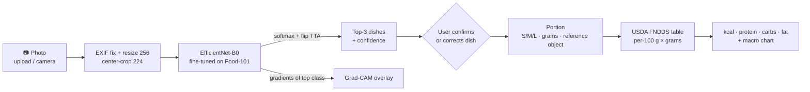

# 🍽️ NutriSnap: food photo → dish → portion → calories & macros

[](https://colab.research.google.com/github/harshskapadia/Calories-/blob/main/notebooks/nutrisnap_colab.ipynb) [](tests/)   

Snap or upload a photo of a meal. NutriSnap recognises the dish (101 classes), shows **where the
model looked** (Grad-CAM), estimates the **portion**, and returns **calories, protein, carbs and fat**,
with every number editable, because the model will sometimes be wrong.

<p align="center"></p>

> ⚠️ **All nutrition values are estimates** (typical USDA recipe × estimated portion). Not medical or dietary advice.

---

## Contents
[Problem](#problem) · [Architecture](#architecture) · [Data](#data) · [Results](#results) · [Error analysis](#error-analysis) · [Portion estimation](#portion-estimation) · [Run locally](#run-locally) · [Deploy to Hugging Face Spaces](#deploy-to-hugging-face-spaces) · [Limitations](#limitations) · [Future work](#future-work)

## Problem
Logging food is the step most people give up on in calorie tracking: searching a database and
guessing grams for every meal is tedious. NutriSnap turns it into one photo plus, at most, a correction:

1. **Classify** the dish from a photo (fine-tuned CNN on Food-101).
2. **Explain** the prediction (Grad-CAM) so users can tell when the model is looking at the wrong thing.
3. **Estimate the portion**: S/M/L presets based on USDA typical servings, a grams slider, or (experimental) a reference object in the photo.
4. **Look up nutrition** from a documented USDA FoodData Central table and scale by grams.

The design assumes the model *will* be wrong sometimes. It shows the top-3 predictions with confidence,
flags low-confidence predictions, and lets the user re-pick the dish, which re-computes the portion,
nutrition and Grad-CAM for the corrected class.

## Architecture



| Path | What it does |
|---|---|
| `data/prepare_food101.py` | Streams `ethz/food101` from the HF Hub once, pre-resizes to 256 px, writes stratified train/val/test manifests (optionally subsets) |
| `data/build_nutrition.py` | Builds `data/nutrition.csv` from USDA FNDDS via a hand-curated class mapping ([sources & method](data/NUTRITION_SOURCES.md)) |
| `src/train.py` | Config-driven fine-tuning: AdamW, warmup + cosine, label smoothing, mixed precision (fp16 CUDA / bf16 CPU), early stopping, checkpoints, CSV + plots, optional W&B |
| `src/evaluate.py` | Top-1, top-5, macro-F1, per-class report, confusion matrix, most-confused pairs, CPU latency |
| `src/ablation.py` | Trains/evaluates several backbones on identical data → results table |
| `src/predict.py` | Single-image inference pipeline (top-k, TTA, Grad-CAM, nutrition) + CLI |
| `src/gradcam.py` | Backbone-agnostic Grad-CAM for any timm model |
| `src/nutrition.py` | Class → nutrition lookup, S/M/L presets, gram scaling |
| `src/portion.py` | Reference-object (card/coin) area-based portion estimate |
| `app/app.py` | Mobile-first Gradio app |
| `notebooks/` | EDA, error analysis, Colab notebook for full-data GPU training |
| `configs/` | YAML experiment configs |
| `tests/` | Unit tests for nutrition, prediction pipeline and portion estimation |

## Data

**Images: [Food-101](https://data.vision.ee.ethz.ch/cvl/datasets_extra/food-101/)** (Bossard et al., ECCV 2014), loaded via
Hugging Face `datasets` (`ethz/food101`). 101 classes × 1,000 images (750 train / 250 test). The training
images were intentionally left uncleaned by the authors and contain some label noise.

| Split | Source | Used for |
|---|---|---|
| train | official train minus 10% (stratified, seed 42) | fitting |
| val | 10% held out of official train | early stopping / model selection |
| test | official test (250/class) | final numbers only |

Augmentations (train): RandomResizedCrop(224, scale 0.35–1), horizontal flip, RandAugment(2, 9),
ColorJitter(0.2), RandomErasing(0.1). Eval: resize 256 → center crop 224. No raw data is committed.

**Nutrition: USDA FoodData Central, FNDDS 2021–2023** (public domain). Every class is mapped by hand to FNDDS
foods: 67 exact matches, 14 close, 18 composite recipes (e.g. caprese = mozzarella + tomato + olive oil + basil),
and 2 documented proxies. Typical serving weights come from FNDDS portion data. See
[data/NUTRITION_SOURCES.md](data/NUTRITION_SOURCES.md).

<p align="center"></p>

## Results

RESULTS_PLACEHOLDER

## Error analysis

ERROR_PLACEHOLDER

## Portion estimation

Three levels, from most to least reliable:

1. **Presets**: *small / medium / large* = 0.6× / 1× / 1.5× the USDA typical serving for the selected dish.
2. **Grams slider**: the user sets an exact weight (e.g. from a kitchen scale).
3. **Reference object (experimental)**: put a credit card (85.6 × 54 mm) or a US quarter (24.26 mm) next to the plate
   and shoot from above. OpenCV finds the reference (a 4-sided contour with the card's aspect ratio, or a Hough
   circle) → pixels per cm → GrabCut segments the food → area in cm² → grams via a per-dish "grams per cm²"
   factor (≈ thickness × density: deep soups 4.0, cakes 3.0, flat foods 0.9, salads 0.6, default 1.5).
   This step is tested on synthetic scenes; on real photos it's a rough estimate (no depth information).

## Run locally

```bash
git clone https://github.com/harshskapadia/Calories-.git nutrisnap && cd nutrisnap
make setup                     # Python 3.11 venv + requirements
make test                      # unit tests (no data or network needed)

# data + training
make data CONFIG=configs/baseline_subset.yaml   # streams Food-101 (~5 GB once), builds splits
make train-baseline                             # 10-class baseline, ~12 min on 4 CPU cores
make train CONFIG=configs/improved_all101.yaml  # all 101 classes (model used by the app)
make evaluate CKPT=checkpoints/improved_all101/best.pt
make ablation                                   # EfficientNet-B0 vs ConvNeXt-Tiny

# app
cp checkpoints/improved_all101/best.pt app/model/nutrisnap.pt   # (already committed)
make run-app                                    # http://localhost:7860
python -m src.predict meal.jpg --portion large --cam-out cam.jpg  # CLI
```

**Full Food-101 on a GPU:** open [`notebooks/nutrisnap_colab.ipynb`](https://colab.research.google.com/github/harshskapadia/Calories-/blob/main/notebooks/nutrisnap_colab.ipynb) in Colab
(T4 or better). Part A launches the app in ~3 min; Part B trains on all of Food-101 and relaunches the app with the new model.

## Deploy to Hugging Face Spaces

```bash
make space                                   # assembles build/space/ (app, src, model, nutrition table)
export HF_TOKEN=hf_...                       # a token with write access
.venv/bin/hf repo create <user>/nutrisnap --repo-type space --space_sdk gradio
make deploy-space SPACE=<user>/nutrisnap
```

`build/space/` contains its own `README.md` with the Spaces YAML header (`sdk: gradio`, `app_file: app/app.py`) and a
slim `requirements.txt`. It runs on the free CPU tier, because inference is ~25 ms/image for EfficientNet-B0.

## Limitations

- **One dish per photo.** Food-101 is single-label, so a plate with steak *and* fries gets one label.
- **Closed set of 101 dishes.** Anything else (e.g. dal, a smoothie) is forced into the nearest class. The low-confidence flag and the manual override mitigate this; they don't solve it.
- **Recipe variance.** Nutrition is a *typical US recipe*. Oil, dressing, cheese and restaurant portions can change calories by ±30–50%.
- **Portion is the biggest error source.** A single photo has no depth. Presets are population averages, and the reference-object method assumes a typical thickness.
- **Training-data bias.** Food-101 is scraped from foodspotting.com: mostly Western restaurant dishes, well-lit and photographed from a typical angle.
- **CPU-trained app model.** The model shipped in the app was trained on CPU on a per-class subset. The full-data GPU run (Colab notebook) is expected to add several accuracy points.

## Future work

- **Multiple items per plate**: YOLO detection or SAM segmentation, then classify each crop and sum the nutrition.
- **Depth-aware portions**: monocular depth (e.g. Depth Anything) or phone LiDAR to estimate volume instead of area.
- **Larger and more diverse label space**: Food-2K, UECFood-256 or ISIA Food-500 for non-Western dishes; open-vocabulary recognition with CLIP-style models.
- **Calibration**: temperature scaling so the low-confidence threshold maps to a known error rate.
- **On-device inference**: export to ONNX or Core ML, int8 quantisation.
- **Learn from corrections**: log user corrections (opt-in) as hard examples for re-training.

## Acknowledgements
Food-101 (Bossard, Guillaumin & Van Gool, 2014) · USDA FoodData Central · timm (Ross Wightman) · Grad-CAM (Selvaraju et al., 2017) · Gradio.
