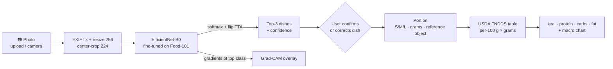

# 🍽️ NutriSnap: food photo → dish → portion → calories & macros

[](https://colab.research.google.com/github/harshskapadia/Calories-/blob/main/notebooks/nutrisnap_colab.ipynb) [](tests/)   

Snap or upload a photo of a meal. NutriSnap recognises the dish (101 classes), shows **where the
model looked** (Grad-CAM), estimates the **portion**, and returns **calories, protein, carbs and fat**,
with every number editable, because the model will sometimes be wrong.

<p align="center"></p>

> ⚠️ **All nutrition values are estimates** (typical USDA recipe × estimated portion). Not medical or dietary advice.

---

## Contents
[Problem](#problem) · [Architecture](#architecture) · [Data](#data) · [Results](#results) · [Error analysis](#error-analysis) · [Portion estimation](#portion-estimation) · [Run on your GPU](#run-on-your-own-gpu-recommended) · [Deploy to Hugging Face Spaces](#deploy-to-hugging-face-spaces) · [Limitations](#limitations) · [Future work](#future-work)

## Problem
Logging food is the step most people give up on in calorie tracking: searching a database and
guessing grams for every meal is tedious. NutriSnap turns it into one photo plus, at most, a correction:

1. **Classify** the dish from a photo (fine-tuned CNN on Food-101).
2. **Explain** the prediction (Grad-CAM) so users can tell when the model is looking at the wrong thing.
3. **Estimate the portion**: S/M/L presets based on USDA typical servings, a grams slider, or (experimental) a reference object in the photo.
4. **Look up nutrition** from a documented USDA FoodData Central table and scale by grams.

The design assumes the model *will* be wrong sometimes. It shows the top-3 predictions with confidence,
flags low-confidence predictions, and lets the user re-pick the dish, which re-computes the portion,
nutrition and Grad-CAM for the corrected class.

## Architecture



| Path | What it does |
|---|---|
| `data/prepare_food101.py` | Streams `ethz/food101` from the HF Hub once, pre-resizes to 256 px, writes stratified train/val/test manifests (optionally subsets) |
| `data/build_nutrition.py` | Builds `data/nutrition.csv` from USDA FNDDS via a hand-curated class mapping ([sources & method](data/NUTRITION_SOURCES.md)) |
| `src/train.py` | Config-driven fine-tuning: AdamW, warmup + cosine, label smoothing, mixed precision (fp16 CUDA / bf16 CPU), early stopping, checkpoints, CSV + plots, optional W&B |
| `src/evaluate.py` | Top-1, top-5, macro-F1, per-class report, confusion matrix, most-confused pairs, CPU latency |
| `src/ablation.py` | Trains/evaluates several backbones on identical data → results table |
| `src/predict.py` | Single-image inference pipeline (top-k, TTA, Grad-CAM, nutrition) + CLI |
| `src/gradcam.py` | Backbone-agnostic Grad-CAM for any timm model |
| `src/nutrition.py` | Class → nutrition lookup, S/M/L presets, gram scaling |
| `src/portion.py` | Reference-object (card/coin) area-based portion estimate |
| `app/app.py` | Mobile-first Gradio app |
| `run_all.py` | One command for the whole pipeline (data → baseline → ablation → final model → evaluation → analysis → app model) |
| `notebooks/` | EDA, error analysis, Colab notebook for full-data GPU training |
| `configs/` | YAML experiment configs |
| `tests/` | Unit tests for nutrition, prediction pipeline and portion estimation |

## Data

**Images: [Food-101](https://data.vision.ee.ethz.ch/cvl/datasets_extra/food-101/)** (Bossard et al., ECCV 2014), loaded via
Hugging Face `datasets` (`ethz/food101`). 101 classes × 1,000 images (750 train / 250 test). The training
images were intentionally left uncleaned by the authors and contain some label noise.

| Split | Source | Used for |
|---|---|---|
| train | official train minus 10% (stratified, seed 42) | fitting |
| val | 10% held out of official train | early stopping / model selection |
| test | official test (250/class) | final numbers only |

Augmentations (train): RandomResizedCrop(224, scale 0.35–1), horizontal flip, RandAugment(2, 9),
ColorJitter(0.2), RandomErasing(0.1). Eval: resize 256 → center crop 224. No raw data is committed.

**Nutrition: USDA FoodData Central, FNDDS 2021–2023** (public domain). Every class is mapped by hand to FNDDS
foods: 67 exact matches, 14 close, 18 composite recipes (e.g. caprese = mozzarella + tomato + olive oil + basil),
and 2 documented proxies. Typical serving weights come from FNDDS portion data. See
[data/NUTRITION_SOURCES.md](data/NUTRITION_SOURCES.md).

<p align="center"></p>

## Results

All numbers are on **held-out test images** (official Food-101 test split, never used for training or model selection).

### Development runs (CPU only, 4 cores; subsets for fast iteration)

| Run | Classes | Train imgs | Backbone | Test top-1 | Test top-5 | Macro-F1 | CPU latency |
|---|---|---|---|---|---|---|---|
| Baseline (`configs/baseline_subset.yaml`) | 10 | 2,000 | EfficientNet-B0 | **89.6%** | 99.6% | 0.895 | 23 ms |
| + RandAugment, ColorJitter, RandomErasing, more data (`configs/ablation_effnet_b0.yaml`) | 20 | 5,000 | EfficientNet-B0 | **91.0%** | 98.8% | 0.910 | 25 ms |

<p align="center"></p>

### Backbone ablation: EfficientNet-B0 vs ConvNeXt-Tiny

Same data, schedule and augmentation; only the backbone (and its standard learning rate) changes.

| Backbone | Params | CPU latency (bs 1, 224 px) | Test top-1 | Test top-5 |
|---|---|---|---|---|
| EfficientNet-B0 | 4.1 M | 25–32 ms | 91.0% (20-class subset) | 98.8% |
| ConvNeXt-Tiny | 27.9 M | 59 ms | full-data GPU run → `results/ablation_gpu.md` | |

Params and latency were measured on this machine (Intel Xeon, 4 threads, fp32). The full-data accuracy comparison
across all 101 classes is produced by `python run_all.py` on a GPU, which writes `results/ablation_gpu.md` and
`results/SUMMARY.md`. ConvNeXt-Tiny costs ~7× the parameters and ~2× the CPU latency, so it has to earn its place
with accuracy. EfficientNet-B0 is the default app model because it serves in ~30 ms on a free CPU Space.


## Error analysis

Full analysis: [`notebooks/02_error_analysis.ipynb`](notebooks/02_error_analysis.ipynb) (EfficientNet-B0, 20-class run, 3,000 test images).

<p align="center"> </p>

**Why it fails**
1. **Fine-grained siblings**: ramen ↔ pho, miso ↔ hot-and-sour soup, cheesecake ↔ strawberry shortcake ↔ carrot cake, beef carpaccio ↔ tartare ↔ caprese. The distinguishing cues (broth clarity, a strawberry layer, the cut of meat) are a few pixels at 224 px.
2. **Label noise and ambiguous photos**: some test "pho" bowls are indistinguishable from ramen, and a "cup_cakes" image is a plated cake slice. Food-101 deliberately contains noise.
3. **Context shortcuts**: in several confident mistakes Grad-CAM sits on a garnish, lemon wedge or plate decoration instead of the food.
4. **Lighting**: dark or coloured restaurant light removes the colour cues that separate raw beef from cooked pork.

<p align="center"></p>

**What it means for the product**

| Finding | Number | Design consequence |
|---|---|---|
| Top-3 accuracy | 97.7% | show the top-3 list, one tap to correct |
| Errors with the true dish in the top-3 | 74% | most mistakes are fixable without typing |
| Accuracy when confidence < 0.4 (6% of images) | 43% vs 94% | the low-confidence warning targets the right images |
| Misclassifications within 20% of the true kcal | only 27% (median error ~120 kcal) | errors are expensive in calories, so the correction UI matters more than another +1% accuracy |

<p align="center"></p>

## Portion estimation

Three levels, from most to least reliable:

1. **Presets**: *small / medium / large* = 0.6× / 1× / 1.5× the USDA typical serving for the selected dish.
2. **Grams slider**: the user sets an exact weight (e.g. from a kitchen scale).
3. **Reference object (experimental)**: put a credit card (85.6 × 54 mm) or a US quarter (24.26 mm) next to the plate
   and shoot from above. OpenCV finds the reference (a 4-sided contour with the card's aspect ratio, or a Hough
   circle) → pixels per cm → GrabCut segments the food → area in cm² → grams via a per-dish "grams per cm²"
   factor (≈ thickness × density: deep soups 4.0, cakes 3.0, flat foods 0.9, salads 0.6, default 1.5).
   This step is tested on synthetic scenes; on real photos it's a rough estimate (no depth information).

## Run on your own GPU (recommended)

Tested path: an NVIDIA GPU with ≥ 6 GB VRAM (e.g. a gaming laptop), Windows or Linux, Python 3.11, ~15 GB free disk.

**1. Get the code and create an environment**

```bash
git clone https://github.com/harshskapadia/Calories-.git nutrisnap
cd nutrisnap
# Windows (PowerShell):            # Linux / macOS:
py -3.11 -m venv .venv             # python3.11 -m venv .venv
.venv\Scripts\activate             # source .venv/bin/activate
```

**2. Install PyTorch with CUDA first, then the rest**

```bash
pip install torch torchvision --index-url https://download.pytorch.org/whl/cu124
pip install -r requirements.txt nbconvert ipykernel
python -c "import torch; print(torch.cuda.is_available(), torch.cuda.get_device_name(0))"   # must print True + your GPU
```
(If it prints `False`, update the NVIDIA driver; pick the CUDA wheel matching your driver at https://pytorch.org/get-started/locally/.)

**3. Run everything with one command**

```bash
python run_all.py --quick     # optional smoke test: 1-epoch runs on small subsets (still downloads the dataset once)
python run_all.py             # the real thing
```

| Step | What happens | Rough time on a laptop RTX 3060/4060 |
|---|---|---|
| `check`, `test` | GPU check, 29 unit tests | 1 min |
| `data` | downloads Food-101 from Hugging Face (~5 GB), pre-resizes to 256 px, builds splits | 15–25 min (network-bound) |
| `baseline` | 10-class baseline | 2–3 min |
| `ablation` | EfficientNet-B0 vs ConvNeXt-Tiny on **all 101 classes, full data** → `results/ablation_gpu.md` | ~1.5–3 h |
| `final` / `evaluate` | final model (EfficientNet-B0 by default; reused from the ablation) on the 25,250-image test split | minutes |
| `analysis` | executes the error-analysis notebook for the final model | 2 min |
| `export` | fp16 app model → `app/model/nutrisnap.pt` | seconds |
| `summary` | `results/SUMMARY.md` | seconds |

Useful flags: `--steps data ablation` (run selected steps; finished steps are skipped on re-runs),
`--final-config configs/gpu/ablation_convnext_tiny.yaml` (ship the more accurate ConvNeXt), `--batch-size 16`
(if you see *CUDA out of memory*), `--workers 4` (fewer DataLoader processes).

**4. Use the app and publish your results**

```bash
python app/app.py                    # http://localhost:7860 (set GRADIO_SHARE=1 for a public link to open on your phone)
python -m src.predict meal.jpg --portion large --cam-out cam.jpg     # CLI
git add results app/model notebooks && git commit -m "Full Food-101 results" && git push
```

<details><summary>Individual commands (Makefile, Linux/macOS)</summary>

```bash
make setup && make test
make data CONFIG=configs/gpu/ablation_effnet_b0.yaml
make train CONFIG=configs/gpu/ablation_effnet_b0.yaml
make evaluate CKPT=checkpoints/gpu_ablation_effnet_b0/best.pt
make export-model CKPT=checkpoints/gpu_ablation_effnet_b0/best.pt
make run-app
# any config value can be overridden:
python -m src.train --config configs/full_gpu.yaml --set train.epochs=20 train.batch_size=48
```
</details>

**No GPU?** Open [`notebooks/nutrisnap_colab.ipynb`](https://colab.research.google.com/github/harshskapadia/Calories-/blob/main/notebooks/nutrisnap_colab.ipynb) in Colab (free T4): it trains on full Food-101, evaluates, and launches the app with a public link.

## Deploy to Hugging Face Spaces

After `python run_all.py` has produced `app/model/nutrisnap.pt`:

```bash
python scripts/build_space.py            # assembles build/space/ (app, src, model, nutrition table, examples)
hf auth login                            # paste a Hugging Face token with *write* access
hf repos create <your-hf-username>/nutrisnap --type space --space-sdk gradio
hf upload <your-hf-username>/nutrisnap build/space . --repo-type space
```

The Space builds in a few minutes at `https://huggingface.co/spaces/<your-hf-username>/nutrisnap`.
`build/space/` has its own `README.md` with the Spaces YAML header (`sdk: gradio`, `app_file: app/app.py`) and a
slim `requirements.txt`. It runs on the free CPU tier (EfficientNet-B0 inference is ~30 ms/image on CPU).

## Limitations

- **One dish per photo.** Food-101 is single-label, so a plate with steak *and* fries gets one label.
- **Closed set of 101 dishes.** Anything else (e.g. dal, a smoothie) is forced into the nearest class. The low-confidence flag and the manual override mitigate this; they don't solve it.
- **Recipe variance.** Nutrition is a *typical US recipe*. Oil, dressing, cheese and restaurant portions can change calories by ±30–50%.
- **Portion is the biggest error source.** A single photo has no depth. Presets are population averages, and the reference-object method assumes a typical thickness.
- **Training-data bias.** Food-101 is scraped from foodspotting.com: mostly Western restaurant dishes, well-lit and photographed from a typical angle.
- **Development numbers are from subsets.** The results above were produced on a CPU-only machine on 10- and 20-class subsets; full 101-class numbers come from `python run_all.py` on a GPU and land in `results/SUMMARY.md`.

## Future work

- **Multiple items per plate**: YOLO detection or SAM segmentation, then classify each crop and sum the nutrition.
- **Depth-aware portions**: monocular depth (e.g. Depth Anything) or phone LiDAR to estimate volume instead of area.
- **Larger and more diverse label space**: Food-2K, UECFood-256 or ISIA Food-500 for non-Western dishes; open-vocabulary recognition with CLIP-style models.
- **Calibration**: temperature scaling so the low-confidence threshold maps to a known error rate.
- **On-device inference**: export to ONNX or Core ML, int8 quantisation.
- **Learn from corrections**: log user corrections (opt-in) as hard examples for re-training.

## Acknowledgements
Food-101 (Bossard, Guillaumin & Van Gool, 2014) · USDA FoodData Central · timm (Ross Wightman) · Grad-CAM (Selvaraju et al., 2017) · Gradio.

Example photos in `app/examples/` are from the Food-101 test split (research use).
